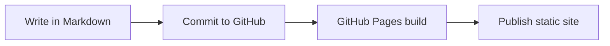

This post exists to verify the first version of the blog stack. It should render
cleanly, stay readable, and cover the Markdown features we care about most.

## What should work

- headings and body copy
- links like [GitHub Pages](https://pages.github.com/)
- blockquotes
- code blocks
- tables
- Mermaid diagrams
- inline math like $E = mc^2$
- display math

> Good defaults matter. They remove friction from publishing.

## Table

| Feature | Status | Notes |
| --- | --- | --- |
| Tables | Ready | Standard Markdown tables render without extra work. |
| Mermaid | Ready | Rendered progressively on the client only when needed. |
| Math | Ready | KaTeX renders on the client after the page loads. |
| Drafts | Ready | Hidden from production, visible in development. |

## Mermaid



## Math

When a model predicts outcomes with a linear hypothesis, we often write:

$$
\hat{y} = \beta_0 + \beta_1 x_1 + \beta_2 x_2
$$

And a simple loss term can be written as:

$$
L(\theta) = \frac{1}{n} \sum_{i=1}^{n}(y_i - \hat{y_i})^2
$$

## Code

```js
const publish = async (post) => {
  const status = post.draft ? "preview" : "production";
  return `${post.title} -> ${status}`;
};
```

## Closing note

If this page looks correct on the final site, the first version of the content
pipeline is in good shape.
